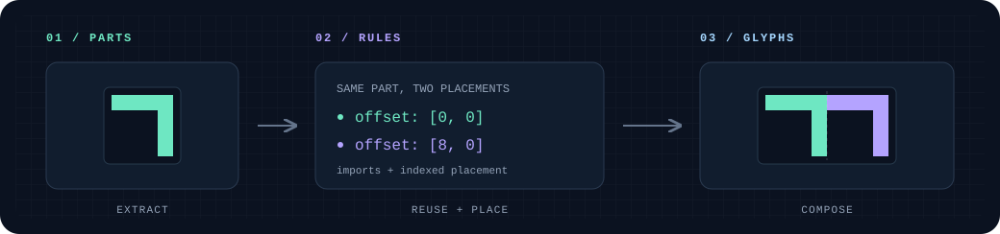

<h1 align="center">JJaim</h1>

<p align="center">
  <strong>부품을 짜서, 글리프로.</strong><br>
  Declarative Glyph Composition
</p>

<p align="center">
  <a href="SPEC.md">명세</a> ·
  <a href="#바로-사용하기">빠른 시작</a> ·
  <a href="examples/">예제</a> ·
  <a href="#도구와-문서">도구와 문서</a>
</p>

<p align="center">
  
</p>

## JJaim, 짜임

**JJaim**(짜임)은 텍스처에서 꺼낸 글리프와 재사용 가능한 그룹을 배치·반복·합성하고, 결과를 선택적으로 유니코드에 연결하는 **선언형 글리프 구성 명세와 도구 모음**입니다.

이름은 부품이 모여 하나의 구조를 이루는 **짜임**에서 가져왔습니다. 글리프를 각각 따로 정의하는 대신, 어떤 부품을 어디에 어떻게 가져올지 기술합니다. 한글 조합은 그 활용 예 중 하나이며, 특정 문자 체계나 폰트 출력 형식에 한정되지 않습니다.

> **명세: [Draft v0.3](SPEC.md)** · 선언 검사기와 두 브라우저 편집기 구현 · TTF 생성기 미구현

| 핵심 | 하는 일 |
| :--- | :--- |
| **부품 재사용** | 텍스처에서 글리프를 추출하거나 다른 그룹을 가져와 새 그룹을 구성합니다. |
| **규칙으로 배치** | 인덱스 구간, 오프셋, 중첩 `repeat`로 여러 글리프의 조합을 기술합니다. |
| **선택적 문자 매핑** | 결과를 유니코드에 연결합니다. 매핑 없는 그룹도 부품으로 재사용할 수 있습니다. |
| **출력과 분리** | 명세는 레이어의 구조·순서·클리핑을 정하고, 픽셀 합성·폰트 출력 정책은 렌더러에 맡깁니다. |

## 작은 조합 예시

하나의 `part`를 두 번 가져와 가로로 나란히 놓으면, 폭이 두 배인 `pair`가 됩니다.

```json
{
  "texture_sets": {"main": {"sheet": "parts.png"}},
  "groups": {
    "part": {
      "size": [8, 8], "count": 1,
      "texture": {
        "set": "main", "source": "sheet",
        "start": [0, 0], "direction": "right"
      }
    },
    "pair": {
      "size": [16, 8], "count": 1,
      "imports": [
        {"group": "part", "offset": [0, 0],
         "at": [{"from": [0, 1], "to": 0}]},
        {"group": "part", "offset": [8, 0],
         "at": [{"from": [0, 1], "to": 0}]}
      ],
      "unicode": [{"from": [0, 1], "to": "U+E000"}]
    }
  }
}
```

- `from: [0, 1]`은 끝을 제외하는 구간이므로 `part[0]` 하나를 가져옵니다.
- 두 임포트는 같은 `pair[0]`에 각각 `(0, 0)`, `(8, 0)` 오프셋으로 배치됩니다.
- `U+E000`은 예시로 선택한 사용자 정의 영역 코드 포인트입니다. `unicode`를 생략해도 그룹 합성은 같습니다.

`parts.png`는 설명용 파일명이며 저장소에 포함되어 있지 않습니다. 바로 실행할 수 있는 선언은 아래의 [예제](#예제)를 사용하세요. 현재 도구는 JSON을 읽지만, 명세 자체의 최종 직렬화 형식은 아직 확정되지 않았습니다.

## 바로 사용하기

### 브라우저에서 탐색하고 편집하기

프로젝트 루트에서 정적 파일 서버를 엽니다.

```sh
python3 -m http.server 8000
```

| 도구 | 주소 | 편집 대상 |
| :--- | :--- | :--- |
| **픽셀 편집기** | <http://localhost:8000/tools/editor/> | 선언은 그대로 두고 원본 PNG의 픽셀을 편집 |
| **선언 편집기** | <http://localhost:8000/tools/declaration-editor/> | 그룹 설명·임포트·텍스처 추출 영역 등 선언을 편집 |

선언 JSON과 그 선언이 참조하는 PNG를 직접 불러옵니다. 예를 들어 `examples/hangul.json`에는 `examples/hangul.png`와 `examples/ascii.png`를 연결합니다.

두 편집기는 별도 프로그램입니다. 설치·빌드·CDN·애플리케이션 백엔드 없이 정적 파일로 동작하며, 위 서버는 파일 제공용입니다. Node.js와 npm은 편집기 테스트에만 필요합니다.

### CLI에서 검사하고 PNG로 미리 보기

Python **3.11 이상**과 [**uv**](https://docs.astral.sh/uv/)가 필요합니다. 프로젝트 루트에서 시작합니다.

```sh
cd tools/inspector
uv sync

# 유니코드 매핑과 그룹·부품 관계 조사
uv run glyph-inspect list ../../examples/hangul.json
uv run glyph-inspect groups ../../examples/hangul.json --format json --parts

# 실제 텍스처를 조합해 PNG 생성
uv run glyph-inspect text ../../examples/hangul.json --text 'JJaim 짜임 ASCII 가각나' --output text.png
uv run glyph-inspect text ../../examples/ascii.json --text 'ASCII' --output ascii.png

# 검사기 테스트
uv run pytest
```

`list`와 `groups`는 텍스처를 열지 않고 선언만 조사합니다. `text`와 `sheet`는 실제 PNG가 필요합니다. 자세한 옵션은 [검사기 사용법](tools/inspector/README.md)을 참고하세요.

## 예제

| 선언 | 구성 | 유니코드 매핑 |
| :--- | :--- | :--- |
| [`hangul.json`](examples/hangul.json) | 344개 한글 부품의 8×4×4벌 조합 + 8×16 ASCII | 한글 11,172자 + ASCII 95자 = **11,267자** |
| [`ascii.json`](examples/ascii.json) | 8×16 ASCII 텍스처의 행별 그룹 | 출력 가능한 ASCII **95자** |

한글은 `U+AC00`–`U+D7A3`, ASCII는 `U+0020`–`U+007E`를 매핑합니다. 한글 조합 규칙은 도구에 하드코딩하지 않고 선언의 임포트·반복으로 표현합니다. 선언과 대응 PNG·원본 BIN은 [`examples/`](examples/)에서 볼 수 있습니다.

<details>
<summary>원본 BIN을 PNG로 변환하기</summary>

제공된 PNG를 그대로 사용하면 변환은 필요하지 않습니다. 아래 명령은 `tools/inspector` 디렉터리에서 실행하며, **입력 BIN 옆의 PNG를 생성하거나 덮어씁니다.** 예제 정본을 보존하려면 복사본에서 실행하세요.

```sh
uv run python ../font_bin_to_png.py ../../examples/hangul.bin
uv run python ../font_bin_to_png.py ../../examples/ascii.bin
```

변환기: [`tools/font_bin_to_png.py`](tools/font_bin_to_png.py)

</details>

## 도구와 문서

| 경로 | 내용 |
| :--- | :--- |
| **[`SPEC.md`](SPEC.md)** | 그룹·텍스처·임포트·반복·유니코드 규칙의 정본 |
| [`tools/inspector/`](tools/inspector/) | 선언 검증·조회·PNG 미리보기 CLI · [사용법](tools/inspector/README.md) / [도구 명세](tools/inspector/SPEC.md) |
| [`tools/editor/`](tools/editor/) | 원본 PNG 픽셀 편집기 · [사용법](tools/editor/README.md) / [도구 명세](tools/editor/SPEC.md) |
| [`tools/declaration-editor/`](tools/declaration-editor/) | 그룹 선언 편집기 · [사용법](tools/declaration-editor/README.md) |
| [`docs/`](docs/) | 8×4×4벌 참고 문서·이전 명세 백업·README 이미지 |

## 현재 범위

- **명세가 먼저입니다.** 의미의 기준은 루트 `SPEC.md`이며, 도구별 명세는 해당 도구의 동작을 구체화합니다. `docs/SPEC.md.bak`는 과거 백업입니다.
- **픽셀 편집과 선언 편집은 분리합니다.** 픽셀 편집기는 선언 원문을 바꾸지 않으며, 전체 텍스처 PNG 또는 PNG만 담은 ZIP을 내보냅니다. 작업·분기 이력은 브라우저의 IndexedDB에 별도로 보존합니다.
- **폰트 파일은 아직 만들지 않습니다.** 현재 도구는 선언 검사·편집·PNG 미리보기를 제공합니다. TTF 생성과 글리프 메트릭 등 출력 설정은 현재 구현 범위 밖입니다.
