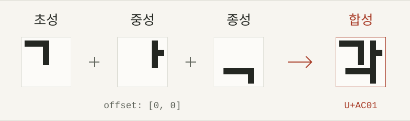

# JJaim <sub>짜임</sub>

<!-- Official 0rwx logos from https://0rwx.com/ (CC0 / public domain). -->
<p>
  <a href="https://0rwx.com/">
    <picture>
      <source media="(prefers-color-scheme: dark)" srcset="docs/assets/AI-X-dark.svg">
      <source media="(prefers-color-scheme: light)" srcset="docs/assets/AI-X-light.svg">
      
    </picture>
  </a>
</p>

<p>
  <strong>부품을 짜서, 글리프로.</strong><br>
  Declarative Glyph Composition · Draft v0.3
</p>

JJaim은 텍스처에서 꺼낸 부품을 배치·반복·합성하고, 결과를 선택적으로 유니코드에 연결하는 **선언형 글리프 구성 명세와 도구 모음**입니다. 글리프를 하나씩 따로 정의하는 대신, 어떤 부품을 어디에 가져올지 기술합니다. 이름은 부품이 모여 구조를 이루는 *짜임*에서 가져왔습니다.

[명세 해설](https://ywbird.github.io/jjaim/) · [명세 원문](SPEC.md) · [예제](examples/) · [도구](#도구와-문서)

<p>
  
</p>

## 바로 사용하기

설치 없이 브라우저에서 시작할 수 있습니다. 구성 규칙이 궁금하면 [명세 해설](https://ywbird.github.io/jjaim/)을, 바로 편집하려면 아래 도구를 여세요.

| 할 일 | 브라우저 도구 | 편집 대상 |
| :--- | :--- | :--- |
| 부품의 모양 고치기 | [텍스처 픽셀 편집기 열기](https://ywbird.github.io/jjaim/tools/editor/) | 선언을 그대로 두고 원본 PNG의 픽셀을 수정 |
| 조합 규칙 고치기 | [그룹 선언 편집기 열기](https://ywbird.github.io/jjaim/tools/declaration-editor/) | 그룹 설명·임포트·텍스처 추출 설정 등을 수정 |

**픽셀 편집기는 프리셋으로 시작하면 됩니다.** `프리셋`에서 ASCII 또는 한글+ASCII를 선택해 새 작업을 열고, 글자에서 부품으로 이동해 편집하세요. 예제는 선택할 때만 불러옵니다. 두 편집기는 서로 다른 프로그램입니다.

직접 만든 선언도 사용할 수 있습니다. 선언 JSON을 열고 그 선언이 참조하는 PNG를 연결합니다. 예를 들어 [`hangul.json`](examples/hangul.json)에는 [`hangul.png`](examples/hangul.png)와 [`ascii.png`](examples/ascii.png)를 연결합니다. 픽셀 편집기는 최신 데스크톱 Chromium과 Firefox를 대상으로 합니다.

## 작은 조합 예시

구성은 세 단계입니다.

1. **꺼내기** — `texture_sets`에 이미지 경로를 등록하고, 그룹의 `texture`로 추출 위치를 정합니다.
2. **배치하기** — `imports`로 다른 그룹을 가져오고, `at`으로 인덱스를, `offset`으로 픽셀 위치를 정합니다. 중첩 `repeat`로 배치를 반복할 수 있습니다.
3. **문자에 연결하기** — `unicode`로 결과 글리프에 코드 포인트를 연결합니다. 매핑 없이 부품으로만 쓰는 그룹도 가능합니다.

아래 선언은 같은 `part[0]`을 `(0, 0)`과 `(8, 0)`에 놓아, 폭이 두 배인 `pair[0]`을 만듭니다.

<details>
<summary>전체 JSON 선언 보기</summary>

```json
{
  "texture_sets": {"main": {"sheet": "parts.png"}},
  "groups": {
    "part": {
      "size": [8, 8], "count": 1,
      "texture": {
        "set": "main", "source": "sheet",
        "start": [0, 0], "direction": "right"
      }
    },
    "pair": {
      "size": [16, 8], "count": 1,
      "imports": [
        {"group": "part", "offset": [0, 0],
         "at": [{"from": [0, 1], "to": 0}]},
        {"group": "part", "offset": [8, 0],
         "at": [{"from": [0, 1], "to": 0}]}
      ],
      "unicode": [{"from": [0, 1], "to": "U+E000"}]
    }
  }
}
```

</details>

`from: [0, 1]`은 끝을 제외하므로 0번 하나를 가져옵니다. 두 임포트는 같은 대상에 별도 레이어로 놓입니다. `U+E000`은 예시로 고른 사용자 정의 영역 코드 포인트이며, `unicode`를 생략해도 합성은 같습니다.

`parts.png`는 설명용 이름으로, 저장소에 포함되어 있지 않습니다. 바로 실행하려면 아래 예제를 사용하세요. 현재 도구는 JSON을 읽지만, 명세 자체의 최종 직렬화 형식은 아직 확정되지 않았습니다.

## 예제

| 선언 | 구성 | 유니코드 매핑 |
| :--- | :--- | :--- |
| [`hangul.json`](examples/hangul.json) | 344개 한글 부품의 8×4×4벌 조합 + 8×16 ASCII | 한글 11,172자 + ASCII 95자 = **11,267자** |
| [`ascii.json`](examples/ascii.json) | 8×16 ASCII 텍스처의 행별 그룹 | 출력 가능한 ASCII **95자** |

한글은 `U+AC00`–`U+D7A3`, ASCII는 `U+0020`–`U+007E`에 연결합니다. 한글 조합은 도구에 하드코딩하지 않고 선언의 임포트·반복으로 표현합니다. 위 도식의 `각`도 실제 예제의 세 부품을 조합한 결과입니다.

선언·PNG·원본 BIN은 [`examples/`](examples/)에 있습니다. 한글의 벌 선택은 [8×4×4벌 참고 문서](docs/about_8x4x4.txt)와 [명세 해설의 한글 예제](https://ywbird.github.io/jjaim/#hangul)를 참고하세요. 한글은 활용 예 중 하나이며, JJaim은 특정 문자 체계나 폰트 출력 형식에 한정되지 않습니다.

예시 텍스처 글꼴 출처: [IT문화원 글꼴 자료](https://ith.kr/about/font2.html).

## 로컬 실행

### 브라우저 도구

저장소 루트에서 정적 파일 서버를 엽니다.

```sh
python3 -m http.server 8000
# 명세 해설: http://localhost:8000/
# 픽셀 편집기: http://localhost:8000/tools/editor/
# 선언 편집기: http://localhost:8000/tools/declaration-editor/
```

서버는 파일 제공용입니다. 웹 해설과 두 편집기는 빌드·CDN·애플리케이션 백엔드 없이 정적 파일로 동작합니다. Node.js와 npm은 편집기 테스트에만 필요합니다.

### 선언 검사기

Python **3.11 이상**과 [uv](https://docs.astral.sh/uv/)가 필요합니다. 저장소 루트에서 시작합니다.

```sh
cd tools/inspector
uv sync

# 텍스처 없이 유니코드 매핑과 그룹·부품 관계 조회
uv run glyph-inspect list ../../examples/hangul.json
uv run glyph-inspect groups ../../examples/hangul.json --format json --parts

# 실제 PNG를 조합해 한글 문자와 ASCII 미리보기 생성
uv run glyph-inspect text ../../examples/hangul.json --text 'JJaim 짜임 ASCII 가각나' --output text.png
uv run glyph-inspect text ../../examples/ascii.json --text 'ASCII' --output ascii.png

# 검사기 테스트
uv run pytest
```

`list`와 `groups`는 선언만 조사합니다. `text`와 `sheet`는 실제 PNG가 필요합니다. 전체 옵션은 [검사기 사용법](tools/inspector/README.md)에 있습니다.

<details>
<summary>원본 BIN을 PNG로 변환하기</summary>

제공된 PNG를 그대로 사용하면 변환은 필요하지 않습니다. 아래 명령은 `tools/inspector`에서 실행하며, **입력 BIN 옆의 PNG를 생성하거나 덮어씁니다.** 예제 정본을 보존하려면 복사본에서 실행하세요.

```sh
uv run python ../font_bin_to_png.py ../../examples/hangul.bin
uv run python ../font_bin_to_png.py ../../examples/ascii.bin
```

변환기: [`tools/font_bin_to_png.py`](tools/font_bin_to_png.py)

</details>

## 도구와 문서

| 경로 | 내용 |
| :--- | :--- |
| **[`SPEC.md`](SPEC.md)** | 그룹·텍스처·임포트·반복·유니코드 규칙의 정본, Draft v0.3 |
| [`index.html`](index.html) | 도식과 코드로 읽는 [웹 명세 해설](https://ywbird.github.io/jjaim/) |
| [`tools/editor/`](tools/editor/) | 텍스처 픽셀 편집기 · [사용법](tools/editor/README.md) / [도구 명세](tools/editor/SPEC.md) |
| [`tools/declaration-editor/`](tools/declaration-editor/) | 그룹 선언 편집기 · [사용법](tools/declaration-editor/README.md) |
| [`tools/inspector/`](tools/inspector/) | 선언 검증·조회·PNG 미리보기 CLI · [사용법](tools/inspector/README.md) / [도구 명세](tools/inspector/SPEC.md) |
| [`docs/`](docs/) | 해설 자산·테스트·8×4×4벌 참고 문서. `SPEC.md.bak`는 이전 명세 백업 |

<details>
<summary>GitHub Pages 배포 구조</summary>

공개 주소는 <https://ywbird.github.io/jjaim/>입니다. 루트 `index.html`이 진입점이며, 두 편집기는 각 `tools/` 경로에서 열립니다. `.nojekyll`로 Jekyll 변환 없이 정적 파일을 그대로 배포합니다.

이미지·CSS·JavaScript·편집기 링크는 상대 경로를 사용하므로 `/jjaim/` 하위 경로와 로컬 서버에서 같은 파일로 동작합니다. 웹 해설의 명세·사용법 원문 링크는 GitHub의 Markdown 문서로 연결합니다.

</details>

## 현재 범위

**구성 명세와 출력 형식은 별개입니다.** 루트 `SPEC.md`가 선언 의미의 정본이고, 도구별 명세는 각 프로그램의 동작만 구체화합니다. 명세는 레이어의 참조·배치·순서·경계를 정하며, 알파 합성·샘플링·폰트 변환 정책은 렌더러에 맡깁니다. 현재는 선언 검사·편집·PNG 미리보기를 제공하며, **TTF 생성기는 없습니다.** 글리프 메트릭 등 폰트 출력 설정도 현재 구현 범위 밖입니다.

픽셀 편집기는 선언 원문과 최초 원본 PNG를 보존합니다. 작업과 분기 이력은 브라우저의 IndexedDB에 저장합니다. 내보내는 파일은 목적에 따라 구분합니다.

- **PNG / 일반 텍스처 ZIP** — 현재 텍스처 이미지만 전달합니다. ZIP에는 PNG만 들어가며, 선언·이력은 포함하지 않습니다.
- **`.jjaim` 프로젝트** — 선언 원문·현재 PNG·전체 이력과 분기·선택/보기 상태를 함께 보관합니다. 다시 열면 기존 작업을 덮어쓰지 않고 새 작업으로 엽니다.

브라우저 저장은 같은 프로필과 오리진에 한정됩니다. 로컬 서버와 GitHub Pages 사이에 작업이 자동으로 이전되지는 않습니다. 작업 상태까지 옮기려면 `.jjaim`을 사용하세요.
